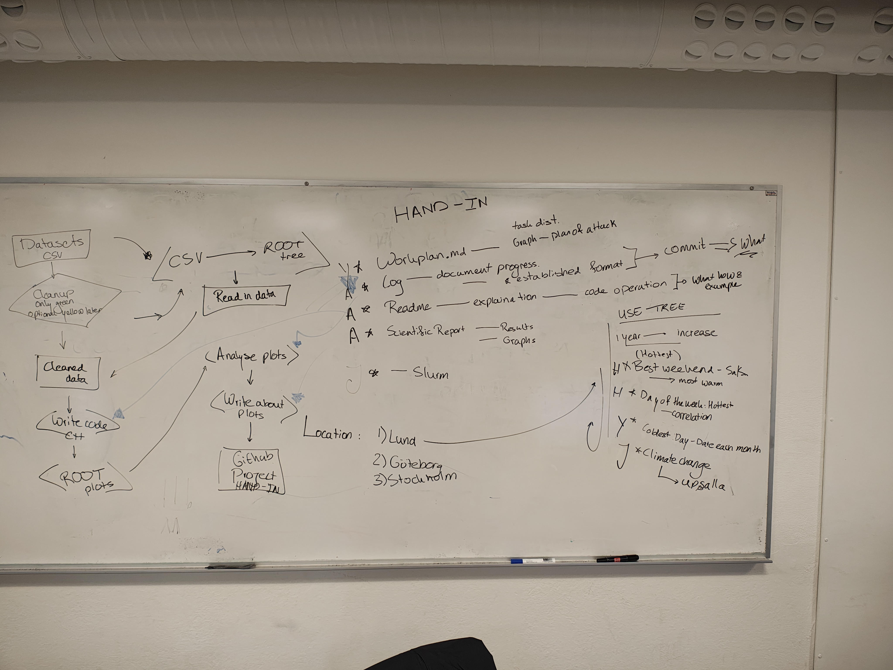

# Workplan for MNXB11 project

Team number: 2  
Team members: Jarl Olsson (Release Manager), Yoline Ruiter, Hanna Palm  

# Time plan
We met up and made an outline on Monday Oct 19:

- Attempt to have some plots by Monday Oct 26.
- Write project report on Tuesday (Oct 27) and Wednesday (Oct 28)
- Revise everything on Thursday (Oct 29) and hand in project
- Friday Oct 30: Project presentation! 

# Tasks
## Writing report + prepare for presentation
- Each person responsible for writing about their task

## Things we want to look at / analyze

### 1. Hottest weekend (Saturday + Sunday)
Responsible for task: Hanna

### 2. Hottest day of the week 
Is there a correlation between day of the week and the temperature?

Responsible for task: Hanna

### 3. Coldest date each month
Responsible for task: Yoline

### 4. Climate change (Uppsala)
Responsible for task: Jarl

## SLURM
Jarl will attempt to run the project as a slurm job.  
